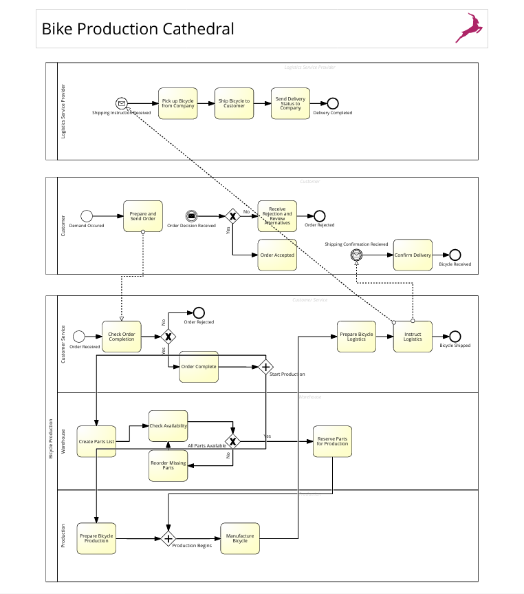

# 🔄️ Process Modeling: Bicycle Production

## 📝 Project Overview 
This project models how a bicycle manufacturer handles a customer order across organizational boundaries. The diagram shows who does what, in what oder, what decisions are made and which activities happen in parallel.

**Business goal:** Make the order-to-delivery flow explicit so that handovers, decision points and dependencies can be understood, analyzed and improved.

## 🛠️ Tool Used
- **SAP Signavio** (BPMN 2.0 modelling)

## ⚙️ How It Works
1. **Order submission:** The Customer prepares and sends an order
2. **Order validation:** Customer Service checks the order for completeness. An incomplete order is rejected, and customer gets notified
3. **Start production:** A complete order triggers a parallel gateway that launches two streams of work at once
4. **Warehouse stream:** The warehouse create a part lists and check availability
5. **Production stream:** Production prepares for manufacturing
6. **Manufacturing:** Once both streams are ready, the bicycle is manufactured
7. **Logistics:** Customer Service prepares logistics and instruct the logistics Service Provider
8. **Delivery:** The provider picks up the bicycle, ships it to the customer
9. **Confirmation:** Customer receives a shipping confirmation and confirms delivery, which completes the process

## 🧠 Skills Demonstrated
- Business process modelling and BPMN 2.0 notation
- Translating written scenario into structured, readable process diagram
- Identifying decision points, exception paths, and parallel work
- Clear documentation and communication of process to a non-technical audience

## 💡What I Learned
- How to break a business scenario into participants and responsiblities
- How to model decisions and exceptions
- How to explain process logic clearly

## 🔗 Preview

  
